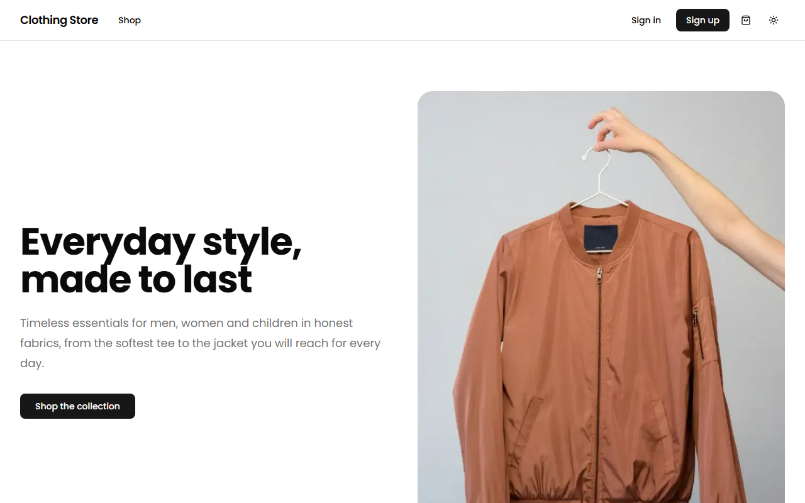
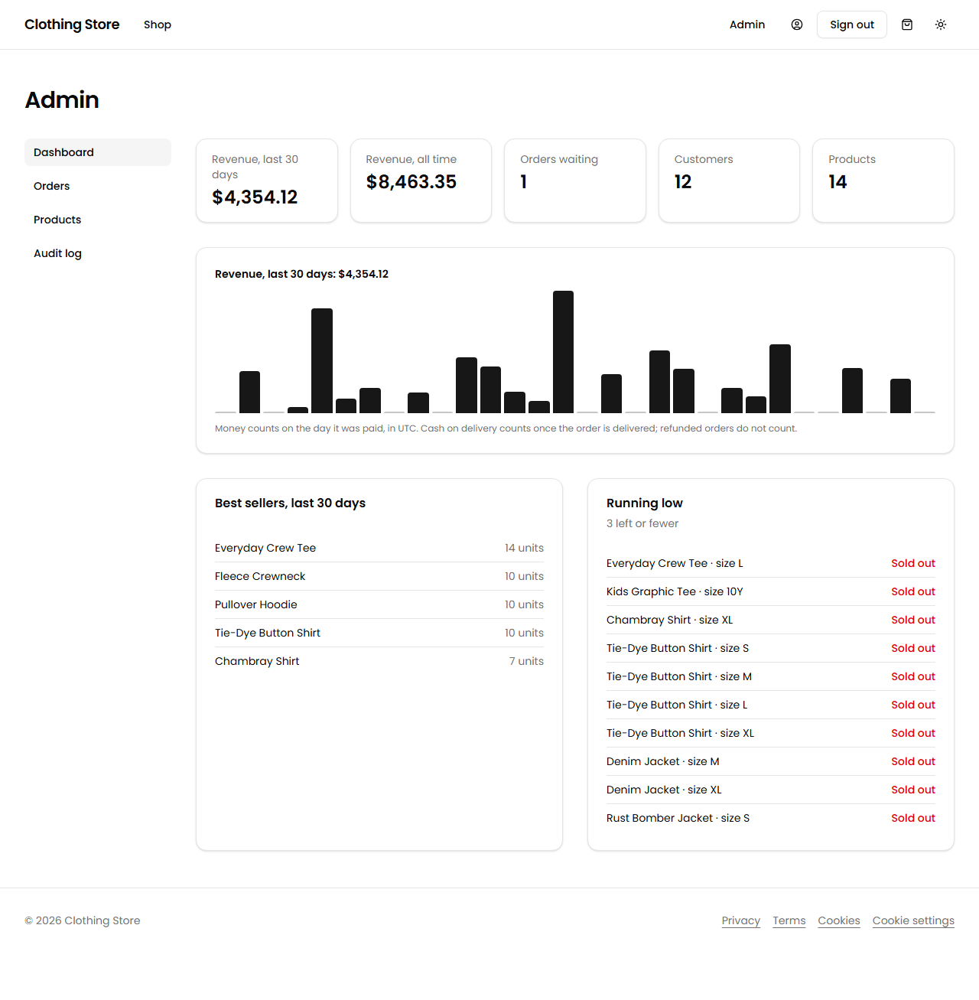
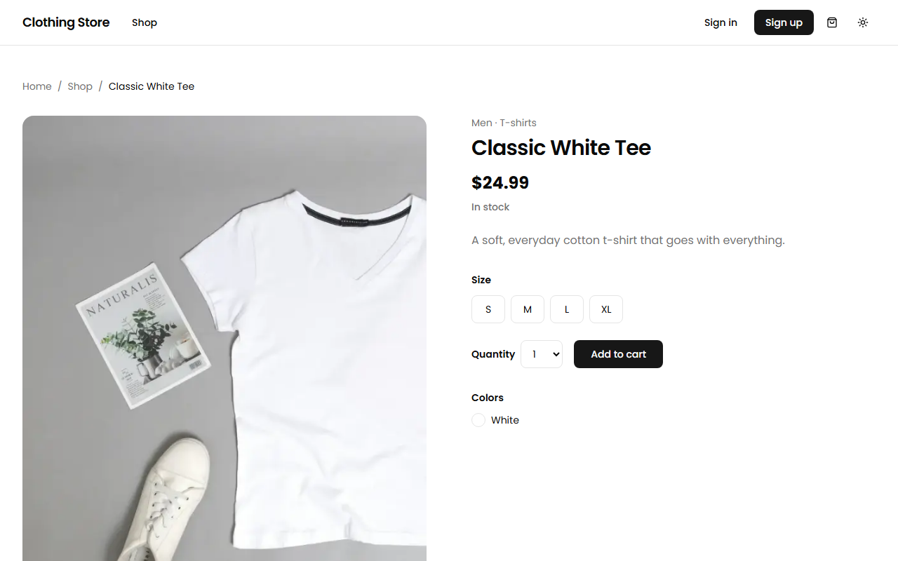
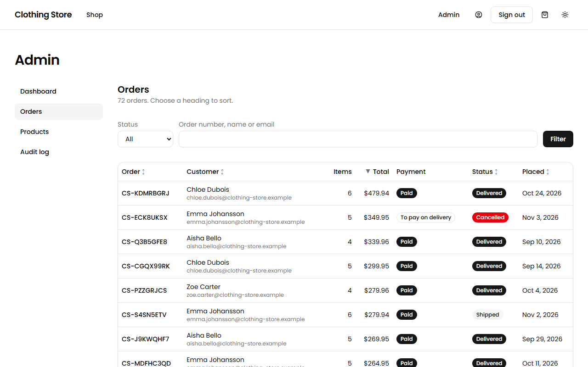
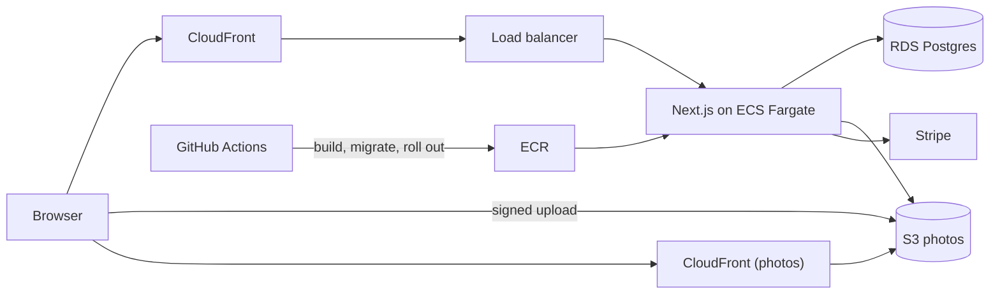

# Clothing Store

An online clothing store built end to end with Next.js and TypeScript: a shop, accounts, checkout with Stripe, an admin area, photo uploads to S3, and the AWS infrastructure and delivery pipeline that run it. The repository was assembled one reviewed pull request at a time, and each change ships with its tests and documentation.

<p>
  
  
</p>
<p>
  
  
</p>

## What it demonstrates

- **A checkout that cannot oversell or double-charge.** Stock is taken with a guarded update inside one transaction, orders are idempotent, and a payment is believed only when Stripe's signed webhook says so.
- **An admin area with an audit trail.** Orders move through enforced statuses, refunds survive Stripe failures, product edits are checked against the stock the admin saw, and every change is logged in the same transaction.
- **Uploads that never touch the app server.** Photos go straight to S3 with a signed form that S3 itself enforces, and are checked again by their first bytes.
- **Security and privacy built in.** A nonce-based Content-Security-Policy, server-side access checks on every page and action, consent before any analytics, and legal pages that describe what the shop really stores.
- **Infrastructure and delivery as code.** A three-tier AWS network (Pulumi), a container image per commit, migrations before every rollout, automatic rollback, and continuous delivery from GitHub Actions.
- **Quality checked by machines.** Unit, component, integration and browser tests, an accessibility scan of every page, Lighthouse in CI, and structured logs.

## Architecture



Each tier accepts traffic only from the one in front of it, and the database has no route to the internet. [infra/README.md](infra/README.md) has the full topology, the cost, and how to apply and remove it.

## Stack

| Area            | Choice                                         |
| --------------- | ---------------------------------------------- |
| Framework       | Next.js (App Router), React, TypeScript strict |
| Styling         | Tailwind CSS 4, shadcn/ui (Radix), Lucide      |
| Authentication  | Better Auth: email and password, Google        |
| Email           | Nodemailer over SMTP, Mailpit locally          |
| Payments        | Stripe Checkout and signed webhooks            |
| Database        | PostgreSQL 16, Prisma 7                        |
| Photos          | S3 with signed uploads, a stand-in locally     |
| Configuration   | Environment validated at startup (zod)         |
| Package manager | pnpm                                           |
| Linting         | ESLint (Next.js config) and Prettier           |
| Tests           | Vitest, Testing Library, axe                   |
| Git workflow    | Husky, lint-staged, commitlint                 |
| CI              | GitHub Actions                                 |

## Getting started

Requires [Node.js](https://nodejs.org) 24, [pnpm](https://pnpm.io) 12 (`corepack enable` picks up the pinned version) and [Docker](https://www.docker.com).

```bash
pnpm install
cp .env.example .env
pnpm compose        # starts the databases, mail catcher and photo storage
pnpm storage:setup  # creates the photo bucket in the local storage
pnpm db:deploy      # applies the migrations to the development database
pnpm db:seed        # fills it with sample products
pnpm dev
```

The app runs on http://localhost:3000. Edit `.env` first: set `BETTER_AUTH_SECRET` (`openssl rand -base64 32`) the Google credentials and, for card payments, the Stripe test keys (see the comments in `.env.example` and Payments below). Every email the app sends, such as verification and password-reset links, lands in Mailpit at http://localhost:8025.

| Endpoint          | Meaning                                                        |
| ----------------- | -------------------------------------------------------------- |
| `GET /api/health` | Liveness: the process is running                               |
| `GET /api/ready`  | Readiness: the database answers (`503` with no details if not) |

## What the shop does

A short list; [docs/features.md](docs/features.md) has the detail of each.

- **Shop and cart:** filter, search and sort in the URL; a cart in the browser that the server prices.
- **Accounts:** verified email or Google sign-in, saved addresses, order history.
- **Checkout and payments:** card (Stripe) or cash on delivery, with stock held from the moment the order is made.
- **Admin:** a dashboard, sortable order and product lists, order handling with refunds, product editing with photos, an audit log.
- **Demo mode:** demo accounts and 72 sample orders (`pnpm db:seed:demo`), with a read-only demo admin.
- **Privacy and security:** legal pages, cookie consent, a Content-Security-Policy.

## Infrastructure and deployment

- **`Dockerfile`** builds two images from one commit: the app (a Next.js standalone server) and a one-off migration job (`--target migrate`).
- **`infra/`** is the AWS setup as a Pulumi program: a VPC with public, app and data tiers over two zones, ECS Fargate behind a load balancer and CloudFront, RDS Postgres in the data tier, a private S3 bucket for photos served through its own CloudFront address, Secrets Manager, and a monthly budget alert. [infra/README.md](infra/README.md) shows the topology, the cost, and how to apply and remove it.
- **Deploy** is continuous delivery to production (`.github/workflows/deploy.yml`): when CI passes on `main`, the commit that passed is built, its migration runs first (and stops everything if it fails), the service rolls onto the new image, and the workflow checks the rollout really completed and the site answers. There are two environments, local and production. A repository variable, `DEPLOY_ENABLED`, switches it on and off so merges do not deploy to a stack that is not running. GitHub signs in to AWS either with a short-lived token for this repository and environment, or (where an organisation forbids that, as for this account) with the key of a deploy-only user kept as a secret.

## Quality

### Testing

Unit tests (`*.test.ts`) need nothing running. Component tests (`*.test.tsx`) render React in a simulated browser and include an accessibility check with axe. Integration tests (`*.integration.test.ts`) use the real test database from `pnpm compose`, run one file at a time, and have their migrations applied automatically before the run. End-to-end tests (`e2e/*.spec.ts`) drive a real browser through sign-up, email verification, sign-in, password reset and browsing the sample catalog against a production build, reading the emails from Mailpit. They need `pnpm compose` running and, the first time, `pnpm exec playwright install chromium`. They use the test database, so do not run them at the same time as the integration tests.

### Quality gates

Locally, a pre-commit hook lints and formats staged files, and a commit-msg hook enforces [Conventional Commits](https://www.conventionalcommits.org). CI runs lint, format, typecheck, unit, component, integration and end-to-end tests and a build on every pull request, and checks every commit message in it.

See [CONTRIBUTING.md](CONTRIBUTING.md) for the workflow, and [docs/decisions.md](docs/decisions.md) for the reasoning behind the main choices.

### Logs, errors and quality checks

- **Logs** are one JSON object per line (`logger` in `src/lib/logger.ts`), errors on stderr, so a log service reads them without parsing rules. Every error that escapes a page, a route handler or a server action is logged with its route and request by `onRequestError` (`src/instrumentation.ts`); alert on `"level":"error"`.
- **Accessibility:** component tests check each piece with axe, and `e2e/a11y.spec.ts` scans the public, account and admin pages (WCAG 2.1 A and AA) in a real browser.
- **Lighthouse** runs in CI against the production build with the sample catalog (`lighthouserc.json`). Accessibility and best-practices scores fail the job below a threshold; performance only warns, because a shared runner's timings are too noisy to gate on. The report is kept as a build artifact. `pnpm exec lhci autorun` runs it locally.

## Scripts

| Script                                      | Purpose                                                             |
| ------------------------------------------- | ------------------------------------------------------------------- |
| `pnpm dev`                                  | Start the development server                                        |
| `pnpm build` / `pnpm start`                 | Production build, and serve it                                      |
| `pnpm lint` / `pnpm lint:fix`               | Check, or fix, lint errors                                          |
| `pnpm format` / `pnpm format:check`         | Write, or check, formatting                                         |
| `pnpm typecheck`                            | Generate route types and run `tsc`                                  |
| `pnpm test` / `pnpm test:watch`             | Unit and component tests, once or watching                          |
| `pnpm test:integration`                     | Integration tests (needs `pnpm compose`)                            |
| `pnpm test:e2e`                             | End-to-end tests in a browser (see Testing)                         |
| `pnpm compose` / `pnpm compose:down`        | Start or stop the local databases                                   |
| `pnpm db:generate`                          | Generate the Prisma client                                          |
| `pnpm db:migrate` / `pnpm db:deploy`        | Create and apply, or only apply, migrations                         |
| `pnpm admin:grant <email>` / `admin:revoke` | Make an account an admin, or take it away                           |
| `pnpm storage:sweep [--dry-run]`            | Delete photo files nothing uses                                     |
| `pnpm db:seed`                              | Replace the dev catalog with sample products                        |
| `pnpm db:seed:demo`                         | The sample catalog plus demo accounts and orders                    |
| `pnpm screenshots`                          | Take the pictures in `docs/screenshots` from a running, seeded copy |
| `pnpm db:studio`                            | Browse the database                                                 |

## Project structure

```text
src/app/          routes, layouts, error and not-found pages, route handlers
src/components/   ui/ holds shadcn primitives, layout/ the page shell, catalog/ the shop, cart/ the cart
src/env.ts        the validated environment, the only place variables are read
src/lib/db/       the Prisma client
src/lib/catalog/  product queries, shop URL parsing, price formatting
src/lib/cart/     the cart store, its server lookup and the pure totals
src/lib/address/  saved addresses: the country rules, validation and the queries
src/lib/orders/   placing and reading orders, shipping and statuses
src/lib/payments/ the Stripe client, the webhook and the card payment page
src/lib/admin/    admin roles, the audit log and the dashboard queries
scripts/          commands an operator runs (admin, storage, screenshots)
src/lib/auth/     Better Auth setup, server-side guards and form schemas
src/lib/email/    SMTP mailer and email templates
src/proxy.ts      redirects for signed-out and signed-in visitors
src/test/         test helpers and global setup
prisma/           schema and migrations
docker/           local PostgreSQL (development and test databases) the mail catcher and a stand-in for the Stripe API
e2e/              end-to-end tests (Playwright)
docs/             decisions, features, known limitations, screenshots
infra/            the AWS infrastructure (Pulumi), by tier
Dockerfile        the app image and the migration image
public/products/  sample product photos, with their credits
.github/          CI workflow, shared setup action, Dependabot, PR template
.husky/           Git hooks: lint-staged on commit, commitlint on message
```

## More documentation

- [docs/features.md](docs/features.md): what each part of the shop does and why.
- [docs/decisions.md](docs/decisions.md): the reasoning behind the main choices, indexed at the top.
- [docs/known-limitations.md](docs/known-limitations.md): what the project does not do.
- [infra/README.md](infra/README.md): the AWS topology, cost, and how to apply and remove it.
- [CONTRIBUTING.md](CONTRIBUTING.md): the workflow and the conventions.
